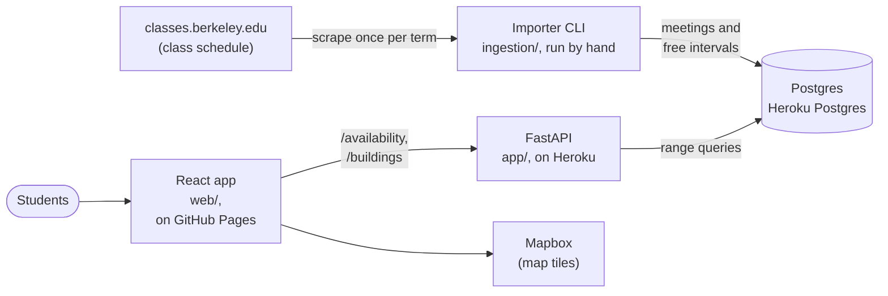

# Design

How Get a Room works and why it was built that way. This is the final version
of the design document written in September 2026, updated to describe what was
actually built. Where the build moved away from the original plan, the section
says so and why.

- [Introduction and overview](#introduction-and-overview)
- [System architecture](#system-architecture)
- [Data storage design](#data-storage-design)
- [Data quality: Fall 2026](#data-quality-fall-2026)
- [Limitations](#limitations)
- [Open questions](#open-questions)

## Introduction and overview

### Problem

UC Berkeley has roughly 45,000 students and a well-known shortage of places to
work. Popular study spaces fill up quickly, and students end up circling
buildings, checking rooms at random, or giving up and going home. Meanwhile,
hundreds of classrooms sit empty for hours between lectures. The space exists;
students just have no way to find it. The information is in a course catalog
that was never designed to answer "where can I sit right now?"

### Solution

Berkeley publishes its full class schedule: every section, its assigned room,
and its meeting times. Taking the complement of that schedule gives, for any
moment, the rooms with nothing booked in them. Get a Room shows that set as a
searchable, filterable list of rooms next to a campus map.

### Goals

- Show which classrooms are free right now, **how long they'll stay free**,
  and **where they are**. A room that fills up in four minutes isn't useful.
- Cover the main academic buildings, with the schedule imported each term.

Not goals: reservations, live occupancy, or any promise that a free room is
unlocked or open to students. Only scheduled classroom use is tracked, so
non-classroom spaces are out of scope.

**Status:** live at https://getaroomberkeley.me with Fall 2026 data
(import 6, completed 2026-10-12).

## System architecture

The system is an offline batch pipeline plus a read-only API. The importer
fetches the published schedule, parses it into meetings, and inverts those into
each room's free intervals. The API answers searches against the result. No
student request ever touches classes.berkeley.edu.

### The import pipeline

An operator runs `python -m ingestion.cli import run "<term>"` once per term.
[Importing a term](importing.md) has the commands, options and exit codes.

1. **Enumerate the term's sections.** The importer pages through
   `classes.berkeley.edu/taxonomy/term/{id}` (allowed by robots.txt;
   `/search/` isn't) at 10 sections a page until a page has none. Fall 2026 is
   1,007 pages and 10,069 sections. Each page gives `/content/{slug}` links,
   which are deduplicated into a work list. The taxonomy id has to be checked
   by hand: an early attempt imported 8573, which is the 2025 term, not 2026's
   8588. Each page's heading names its term.
2. **Fetch each section page.** There's no bulk API, so each section is one
   server-rendered page, fetched one at a time, one request per
   `SCRAPER_RATE_LIMIT_SECONDS`. The site blocks plain Python HTTP clients by
   their TLS fingerprint, so `ingestion/fetch.py` uses `curl_cffi` with an
   identifiable User-Agent. Timeouts, dropped connections and error statuses
   other than 401, 403 and 404 are retried after 5s, 30s and 2 min, so short
   outages don't fail the run. A section page that still fails is counted as
   failed. A listing page that still fails fails the whole run, since its
   sections would be missed.
3. **Parse each section** (`ingestion/parse.py`):
   - **Location:** building and room, split by taking the trailing room token
     ("242", "B56", "242A") off the building name. Most locations are a
     campus-map link, but some ("Social Sciences Building 155") are plain
     text; both are parsed. Before plain text was handled, about 8% of
     locations were unparseable and their rooms looked free all week.
   - **Meeting pattern:** days and start and end times, one meeting per day.
   - **Section type:** LEC, DIS, LAB, SEM, IND and so on.
4. **Keep only room-occupying sections** (`ingestion/filter.py`). Accepted
   types are LEC, DIS, LAB, GRP and REC, as planned, plus **SEM and STD**:
   Fall 2026's pages showed most seminars and studios use a real classroom,
   and leaving them out made booked rooms look free. A section is also rejected
   if it has no meetings, is online, is waiting on a room ("Requested General
   Assignment"), or has a location that isn't a building and room. Each
   rejection reason is counted.
5. **Scrape first, then write.** The original plan wrote as it went. That held
   one transaction open for hours, and Heroku Postgres closed the connection
   two hours into a run. Now nothing is written until the whole term is
   scraped; then the run is saved in one short transaction. A failed run keeps
   none of its work, and the previous data stays as it was.
6. **Reconcile meetings** (`ingestion/persist.py`). Buildings and rooms are
   created as they're found. Each section's meetings are synced as a set:
   unchanged rows are kept, new ones inserted, and ones the section no longer
   lists (a dropped day, a changed time) deleted. Sections that disappeared
   from the term entirely are then deleted too, but only when every section
   fetched and parsed, since otherwise an unseen section might just be a
   failed one. As a guard, a run that would remove more than half the term's
   sections (`--max-retire-fraction`) aborts instead.
7. **Invert into free time.** `recompute_availability`
   (`app/models/availability/recompute.py`) groups meetings by room and
   weekday, and `invert_intervals` (`inversion.py`) merges overlapping and
   back-to-back meetings and takes the complement within 07:00–22:00. The
   result is stored as `availability_interval` rows, so a search is an indexed
   lookup, not a computation.
   - **Changed from the plan:** the plan was to recompute only the rooms and
     weekdays a run touched. Instead every room in the term is recomputed in
     the import's transaction. It's simpler, can't miss a room, and is cheap:
     573 rooms × 7 days is about 4,000 inversions.
8. **Record the run.** Each run gets an `import_run` row: status, timestamps,
   sections read, imported, rejected and failed, and rejections by reason. A
   completed run stamps the term's `processed_at`.

**Refresh cadence.** Schedules are fixed at the start of a term and change
occasionally (room changes, cancellations). A run is safe to repeat, so the
plan was a weekly re-import. For now imports run by hand. A full term is about
11,000 requests and takes 8 hours or more: import 6 ran for about 17 hours,
including two pauses when the laptop went offline. A scheduled weekly run is
GAR-045 (P1).

### Interval semantics

- **Half-open.** Every interval is `[start, end)`: a class from 10:00 to 11:00
  doesn't include 11:00. Back-to-back classes ending and starting at 11:00
  merge into one busy block, with no zero-length free gap between them.
- **Berkeley's end times are inclusive.** The schedule shows an 89-minute
  block as "10:00 am - 11:29 am", so the parser adds one minute to every end
  time to get the half-open end (11:30).
- **07:00 to 22:00.** Availability covers those hours only. Meetings are
  clipped to that window, so a room free after its last class is free "until
  22:00". Three Fall 2026 meetings fall partly outside it.
- **Weekday, not date.** Meetings and free intervals are keyed by
  `day_of_week` (0 = Monday), and repeat every week of the term. A search for
  a date uses its weekday, and returns nothing outside the term's dates.
- **Local clock time.** Times are clock times in the term's timezone
  (`America/Los_Angeles`). A search converts its moment to that zone and
  searches the local weekday and time, so daylight saving time doesn't shift
  results. Meetings crossing midnight aren't supported; the parser fails such
  a section rather than store a reversed range, and none exist.
- **Minutes.** Times are to the minute. A search at 10:00:30 searches 10:00.
- **Minimum duration is a search filter.** Every free gap is stored as it is,
  however short. The "free for at least" filter (default 60 minutes) is
  applied when searching, and measures the time left from the searched moment,
  not the gap's full length. That keeps the stored data an honest record, and
  leaves "useful" to the student.

### Serving

The API ([reference](api.md)) has three read-only endpoints:

- `GET /availability`: rooms free at a moment (now, a date and time, or a
  weekday and time), with when each stays free until. Filters by minimum
  duration, building and room, and can sort by distance from a point.
- `GET /availability/buildings`: free-room counts per building, for the map.
- `GET /buildings`: every building with a searchable room, with its
  coordinates.

A free-at-time search finds intervals whose range contains the time
(`contains_time` in `app/models/models.py`, the `@>` operator), which the GiST
index answers directly. `/health` reports the app is up; `/ready` also checks
the database and returns 503 without it.

The web app always searches "now". It shows the free rooms grouped by
building, beside a Mapbox campus map with each building's count. Picking a
building on the map, or typing a building or room, filters the list.

### The stack

- **FastAPI and Python.** Typed request validation and generated OpenAPI docs
  at `/docs`. The scraper and the API share one codebase and models.
- **PostgreSQL**, specifically for range types. The domain is time intervals,
  and Postgres has native ranges, overlap and containment operators, GiST
  indexes, and exclusion constraints. The core search is an indexed range
  query rather than a scan in Python.
- **SQLAlchemy and Alembic.** Schema changes are migrations. CI checks there's
  one head, that migrations upgrade from empty, match the models
  (`alembic check`), and downgrade cleanly.
- **Pytest against real Postgres.** The plan said testcontainers; instead the
  tests use the Compose database, in a separate `<db>_test` database, and CI
  runs a Postgres service with `REQUIRE_TEST_DB=1` so they can't silently
  skip. Range types and constraints can't be tested on SQLite.
- **Docker Compose** for local development: one `docker compose up` for the
  API and database.
- **GitHub Actions** runs lint, migration checks and tests on every push.
- **Heroku**, not Fly.io or Railway: a Basic dyno on the container stack plus
  Heroku Postgres Essential-0, covered by the GitHub Student Pack's credit.
  The release step runs `alembic upgrade head`, so a failed migration cancels
  the deploy. See [Deploying to Heroku](deployment.md).
- **React, TypeScript and Vite** for the web app, served as a static site
  from **GitHub Pages**, with **Mapbox GL** for the map.

## Data storage design

Models are in `app/models/models.py`; migrations in `alembic/versions/`.

**`term`**: one row per semester, so schedules are kept apart.
`term_id`, `name` (unique), `start_date`, `end_date`, `timezone` (default
`America/Los_Angeles`), `source_url` (the taxonomy page), `fetched_at`,
`processed_at`, `status` (`active` or `archived`; archived terms refuse
imports).

**`building`**: `building_id`, `name`, `short_code` (unique), `latitude`,
`longitude`, `address`, `included_in_coverage` (default true). Coordinates
aren't in the schedule; they're kept by hand in `data/building_locations.csv`
(see [Building locations](building-locations.md)).

**`room`**: `room_id`, `building_id`, `room_number`, `name`, and `in_use`
(default true). Searches only return rooms that are in use, in covered
buildings (`searchable_rooms()` in `app/api/queries.py`).

**`meeting`**: one row per section, room, weekday and time block.
`meeting_id`, `room_id`, `term_id`, `day_of_week` (one value, 0 = Monday;
not an array), `start_time`, `end_time`, `time_range` (generated),
`meeting_type`, `source_record_id` (Berkeley's section id).

**`availability_interval`**: one free interval for a room on a weekday.
`interval_id`, `room_id`, `term_id`, `day_of_week`, `start_time`,
`end_time`, `time_range` (generated), `source_version`
(`availability-v1`), `computed_at`.

**`import_run`**: one row per import attempt. `import_id`, `term_id`,
`started_at`, `completed_at`, `source_url`, `source_hash`,
`parser_version`, `computation_version`, `records_read`,
`records_imported`, `records_rejected`, `records_failed`,
`rejection_counts` (JSONB, by reason), `status` (`running`, `completed`
or `failed`), `error_message`. `source_hash` exists but isn't filled in yet,
and `parser_version` only when the operator passes `--parser-version`.

### Constraints and indexes

- **`timerange` type.** Postgres has no time-of-day range, so one is created:
  `CREATE TYPE timerange AS RANGE (subtype = time)`, with a `subtype_diff`
  function so GiST can index it well. The `btree_gist` extension lets one GiST
  index mix plain integer columns with the range.
- **Generated `time_range`.** `meeting` and `availability_interval` store
  `start_time` and `end_time`, and Postgres derives
  `time_range = timerange(start_time, end_time, '[)')` from them. Code writes
  plain times, and queries use the range.
- **`uq_meeting_identity`**, unique on `(term_id, source_record_id, room_id,
  day_of_week, start_time, end_time)`. The original plan was unique on
  `(source_record_id, day_of_week)`, but a section can meet in more than one
  block on the same day, or in different rooms, so the identity is the whole
  meeting, scoped to its term. These are also the fields re-imports compare.
- **`ix_meeting_time_range`**, a GiST index on `(term_id, room_id,
  day_of_week, time_range)`, used by the report's overlap check.
- **No exclusion constraint on meetings.** Two sections can really share a room
  at the same time: cross-listed courses, lab sections, or discussions with
  the same teaching assistant. Fall 2026 has 1,217 such pairs. Rejecting them
  would fail the import over real data, so the report counts them instead.
- **`ex_availability_interval_no_overlap`**, an exclusion constraint: for
  one term, weekday and room, no two free intervals may overlap
  (`time_range &&`). Inversion never produces overlaps, so this guards against
  a bug, and its GiST index also serves searches by term, weekday and time.
- **Checks and keys.** `day_of_week BETWEEN 0 AND 6` on both tables; room
  numbers unique within a building; building short codes and term names
  unique; foreign keys from rooms to buildings and from meetings, intervals and
  runs to terms.

The `timerange` setup SQL is in both the `b8e3f1a7c2d5` migration and
`models.py` (so the tests' `create_all` works). `alembic check` doesn't
compare it, so keep the two the same by hand.

## Data quality: Fall 2026

This is the data-quality report (GAR-051) for production import 6, completed
2026-10-12, and the review of it. To see the current one, run
`python -m ingestion.cli import report "Fall 2026"`; see
[Checking an import](importing.md#checking-an-import).

### Coverage

| | |
|---|---:|
| Sections read | 10,069 |
| Imported | 6,496 |
| Rejected | 3,570 |
| Failed (all IND) | 3 |
| Meetings | 9,458 |
| Rooms (all searchable) | 573 |
| Buildings (all covered) | 72 |
| Buildings with coordinates | 65 |

Meetings by type: LEC 3,913, DIS 3,194, LAB 1,005, SEM 823, STD 207, GRP 205,
REC 111.

Because 3 sections failed, the run skipped removing stale meetings. That cost
nothing, as it was the term's first completed import.

### Rejections

| Reason | Sections |
|---|---:|
| Independent study (IND) | 1,784 |
| No meetings | 685 |
| Tutorial (TUT) | 352 |
| Missing location | 245 |
| Other non-room types (COL 133, FLD 47, WOR 23, SES 20, and 8 types under 10) | 246 |
| Online | 171 |
| Unparseable location | 83 |
| Requested general assignment | 4 |

These are as expected. Unparseable locations are 0.8% of sections, down from
about 8% before plain-text locations were parsed. A 300-section sample across
the term found one, `educ-223b-004-lec-004`, which is "Off Campus" and rightly
rejected.

### Duplicate checks

- Exact duplicates can't happen; the constraints above block them.
- No room numbers in one building differ only in case, spacing, punctuation or
  leading zeros, and no building names differ only by a word like "Hall".
- **1,217 pairs of different sections share a room at overlapping times.** Ten
  were checked against Berkeley's pages, and all ten match the source: seven
  are cross-listed "C" courses (e.g. ANTHRO C125B / JAPAN C176, SOCIOL C6 /
  DATA C6), two are ARCH 11A studio sections, one is COMLIT 155 with JEWISH
  110, and some are discussions led by the same teaching assistant. None were
  parse errors.

### Sample availability

Free searchable rooms, of 573: Monday 10:00, 289; Tuesday 14:00, 242;
Friday 18:00, 566. The midday dip and the near-empty Friday evening are what
the schedule should look like.

### What the review changed

- **Coordinates.** The report listed 43 covered buildings without
  coordinates. 36 were added from OpenStreetMap, each checked to lie inside its
  building's outline, and applied to production. The 5 left are listed under
  [Open questions](#open-questions); the other two are the Chou Hall entries
  below.
- **A parser bug** was found: see Chou Hall under
  [Open questions](#open-questions).

## Limitations

What a student can rely on is set out in the web README's
[What it can and can't tell you](../../web/README.md#what-it-can-and-cant-tell-you).
In short:

- **Scheduled, not live.** A room with no class may already be in use.
- **No access guarantee.** A free room may be locked or not open to students.
- **No holidays or breaks.** The schedule repeats every week of the term.
- **07:00 to 22:00 only.**
- **No reservations.**

On the operations side (more in
[Importing a term](importing.md#known-limitations)):

- **A long, fragile import.** A full term takes 8 hours or more, and a failed
  run keeps nothing, so an outage late in a run means starting again. Runs 4
  and 5 failed overnight when Berkeley returned errors for hours.
- **Concurrent imports aren't prevented.** Run one at a time.
- **One term, chosen at build time.** The web app searches the term in its
  `VITE_TERM_ID` setting, so moving to a new term means changing that and
  redeploying.
- **Imports are run by hand**, from a laptop that has to stay awake.

## Open questions

- **Chou Hall combined rooms.** "Chou Hall N440 and N444" and "Chou Hall N540
  and N544" are split into the fake buildings "Chou Hall N440 and" and "Chou
  Hall N540 and", with 17 meetings. The fix belongs in `_split_building_room`
  (`ingestion/parse.py`), with a fixture. Open question: book both rooms, or
  one combined room? The fix reaches production only with the next full
  import, and the two fake buildings then need deleting.
- **Five buildings without coordinates:** Graduate Theological Union (two
  candidate buildings), Student Center (unclear which), Haas Faculty Wing (not
  in OpenStreetMap), 2240 Piedmont and 2547 Bowditch (no clear match). Their
  rooms are searchable but not on the map.
- **Which term is current.** There's no `GET /terms/current`, so the web app
  is built with a term id. An endpoint would let a new term go live without
  redeploying the site.
- **Concurrent imports.** The fix is a unique taxonomy-id column on `term` and
  a lock or check so runs can't overlap. It goes with scheduling.
- **Scheduled refresh (GAR-045).** Where a weekly import would run (a Heroku
  Scheduler job, GitHub Actions, or elsewhere), given that it takes most of a
  day.
- **Resumable imports.** Caching fetched pages on disk would let a failed run
  pick up where it stopped, instead of starting over.
- **Holidays and breaks.** Adding the academic calendar would stop the app
  showing rooms as "free" on days campus is closed.
- **Coverage.** Every scraped building is covered by default. Whether some
  should be left out (libraries, the gym, off-campus sites), and who decides,
  is open.
- **Raw staging table.** Keeping each fetched section's raw data would help
  debugging and re-parsing without a re-scrape. Undecided.
- **Import fingerprints.** `source_hash` is never filled in, and
  `parser_version` only by hand, so it's hard to tell which code produced a
  term's data (GAR-047, P1).
